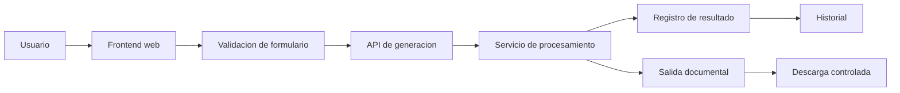

# Arquitectura general

## Alcance

Este documento describe la arquitectura a nivel de componentes. No expone nombres de modulos privados, plantillas, mapeos internos ni reglas completas de procesamiento.

## Componentes

### Frontend

Presenta formularios, estados de carga, validaciones de entrada, historial y una interfaz preparada para futuras funciones de asistencia.

### API

Expone un contrato HTTP para recibir solicitudes y devolver estados o referencias de resultados. La API valida el esquema antes de delegar el trabajo.

### Servicio de procesamiento

Coordina las operaciones necesarias para producir una salida documental. En el sistema privado utiliza plantillas y reglas que no se publican aqui.

### Registro e historial

Permite mostrar el estado general de una solicitud y conservar una referencia de demostracion al resultado.

## Decisiones tecnicas destacadas

- Separacion entre interfaz, API y servicios.
- Validacion en el cliente y en el servidor.
- Procesamiento basado en solicitudes estructuradas.
- Salidas generadas como copias de trabajo, no como modificaciones de originales.
- Exclusión de secretos y materiales propietarios del showcase.
